<div align="center">

<h1 align="center">
<br>
<a href="https://github.com/KLG-Digital"></a>
<br>
<b>GentleSeed</b>
<br>
</h1>

[English](./README.md) · **Français**

[](https://github.com/KLG-Digital/GentleSeed/releases)
[](https://hub.docker.com/r/starkev/gentleseed)
[](https://github.com/KLG-Digital/GentleSeed)
[](https://github.com/KLG-Digital/GentleSeed)
[](./LICENSE)

[**Installation**](#démarrage-rapide) · [**Fonctionnalités**](#fonctionnalités) · [**Documentation**](#documentation) · [**Changelog**](./CHANGELOG.md)

</div>

---

## Description

**GentleSeed** est un sélecteur de releases pour **Radarr** et **Sonarr**. Il surveille les films et séries ajoutés, compare les releases que Radarr/Sonarr trouvent (admissibilité, seeders, codec préféré) et rend la meilleure à Radarr/Sonarr — avec une interface web disponible en **14 langues**.

GentleSeed **ne contacte jamais directement votre client de téléchargement** : Radarr et Sonarr gardent la main sur le téléchargement. GentleSeed est un projet indépendant, non affilié à Radarr, Sonarr ou Prowlarr.

## Fonctionnement

1. Radarr/Sonarr préviennent GentleSeed qu'un film ou une série a été ajouté (webhook, avec une vérification légère toutes les 15 s en filet de sécurité).
2. GentleSeed demande à Radarr/Sonarr les releases disponibles et garde celles qu'ils acceptent.
3. Il les classe par seeders puis, si vous le souhaitez, par codec préféré (H.264 / H.265), et renvoie la meilleure à Radarr/Sonarr.

## Fonctionnalités

| # | Fonctionnalité | Description |
|---|----------------|-------------|
| 1 | Nouveaux médias seulement | La bibliothèque présente au premier lancement est ignorée ; seuls les ajouts suivants sont traités |
| 2 | Détection immédiate | Webhook installé dans Radarr/Sonarr depuis l'interface, plus une vérification légère toutes les 15 s |
| 3 | Choix de la release | Radarr/Sonarr décident de l'admissibilité ; GentleSeed classe par seeders et codec préféré |
| 4 | Packs de saison | Sonarr : tente d'abord un pack de saison, puis épisode par épisode |
| 5 | Recherche manuelle | Comparer les releases de n'importe quel média manquant et en envoyer une après confirmation |
| 6 | Anti-doublon | Contrôle la file et l'historique de Radarr/Sonarr avant tout envoi |
| 7 | Activité en direct | Recherche en cours, demandes reçues, file d'attente, suivi des téléchargements et résultats récents |
| 8 | Journaux | Événements filtrables, aperçu des fichiers en couleurs, téléchargement dans votre langue |
| 9 | Sauvegardes | Sauvegarder et restaurer vos réglages (clés API seulement sur demande) |
| 10 | Avis de mise à jour | Lit les releases GitHub et vous informe — ne se met jamais à jour tout seul |
| 11 | Langues et thèmes | 14 langues, thèmes sombre / clair / automatique et couleurs d'équipe |
| 12 | Indexeurs à ignorer | Cocher les indexeurs (lus dans Radarr et Sonarr) dont GentleSeed ne doit jamais choisir une release |
| 13 | Aucune release dans votre langue | Une release refusée uniquement pour sa langue peut être envoyée après confirmation, ou automatiquement après N recherches vides (désactivé par défaut) |

## Aperçu

Captures de l'interface en anglais (14 langues disponibles).

<details open>
<summary><b>Pages</b></summary>
<br>

| Tableau de bord | Recherches |
|:---:|:---:|
| 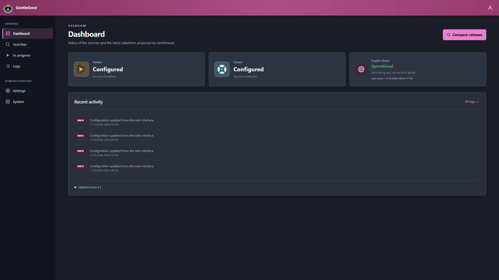 | 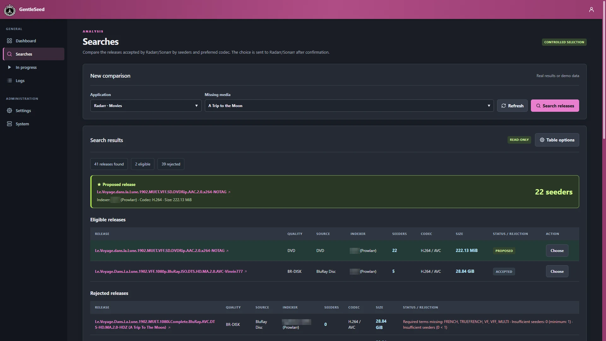 |
| En cours | Journaux |
| 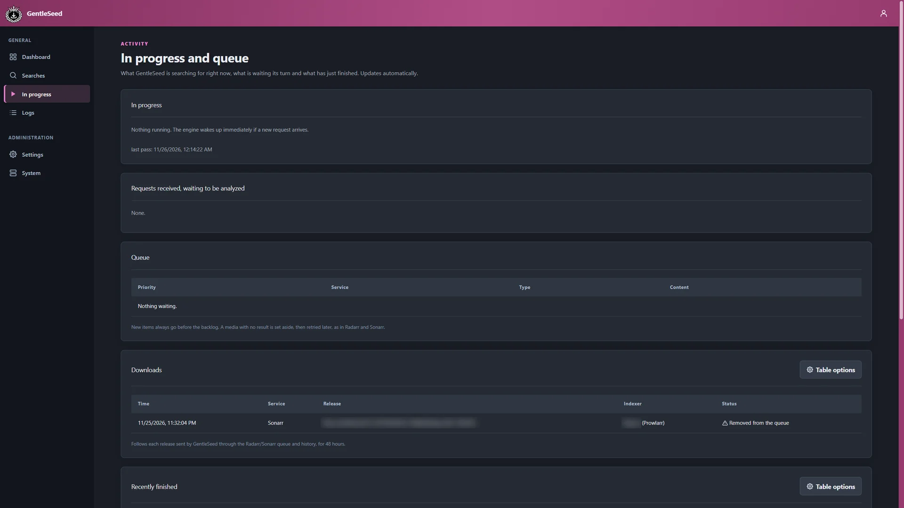 | 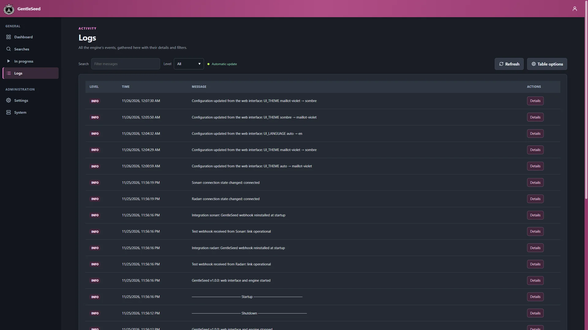 |
| Paramètres | Système |
| 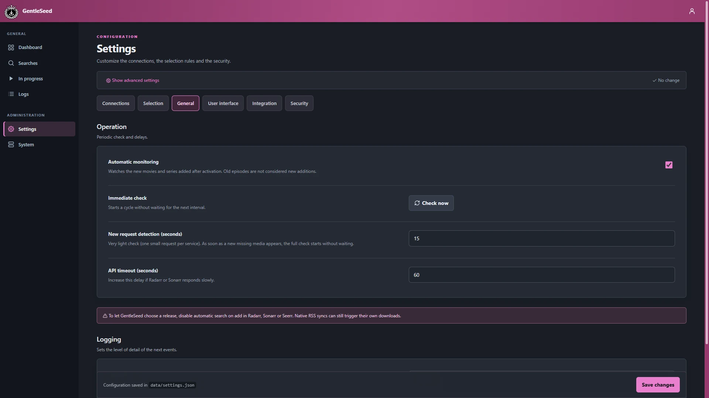 | 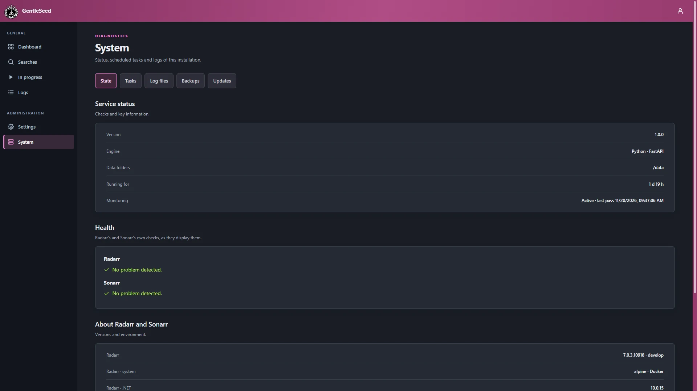 |

</details>

<details open>
<summary><b>Mobile</b></summary>
<br>

| Tableau de bord | Recherches | En cours | Journaux |
|:---:|:---:|:---:|:---:|
| 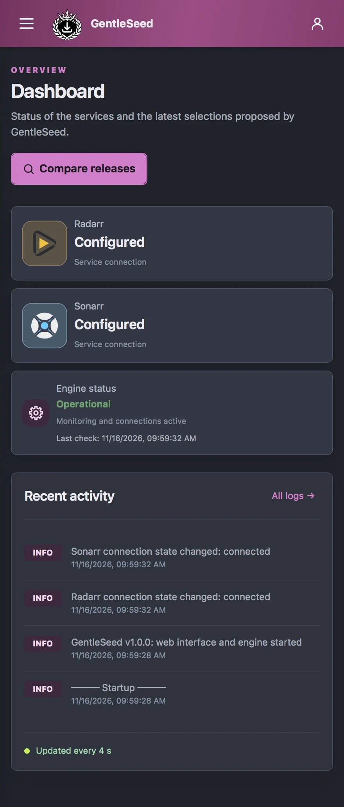 | 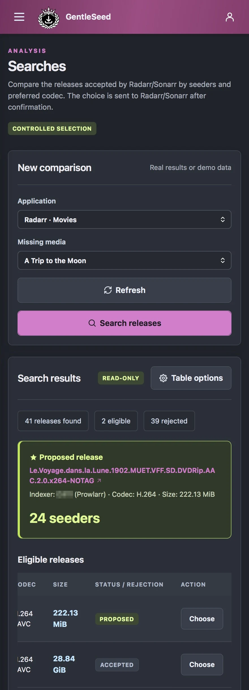 | 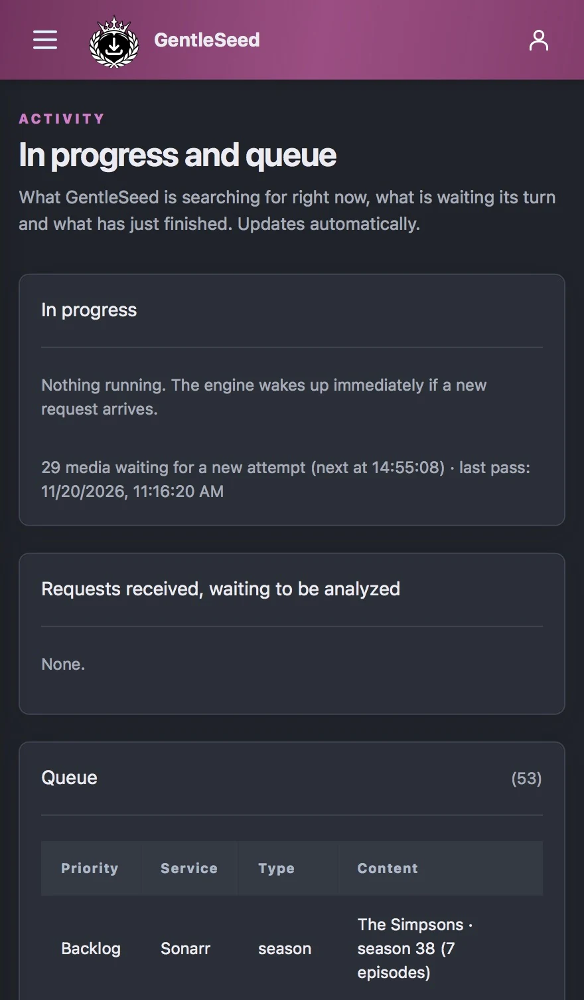 | 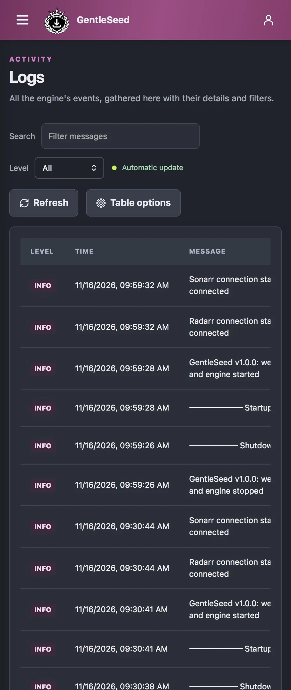 |

</details>

<details>
<summary><b>Thèmes</b></summary>
<br>

**Auto** suit votre système (sombre ou clair). Les cinq derniers sont les thèmes **Gentle Mates**, aux couleurs d'une équipe, dont **Violet (Paris 2027)**.

| Sombre | Clair |
|:---:|:---:|
|  | 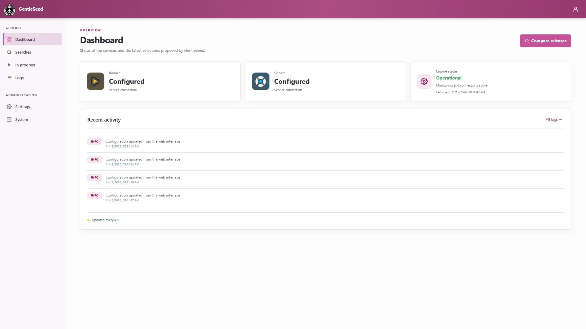 |
| Gentle Mates · Rose pastel | Gentle Mates · Sombre |
| 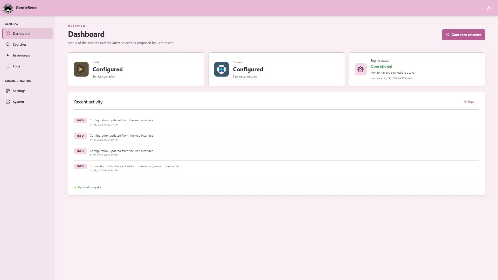 | 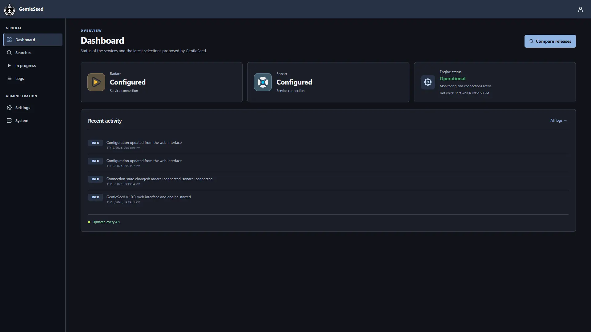 |
| Gentle Mates · Paris (lavande) | Gentle Mates · Bleu |
| 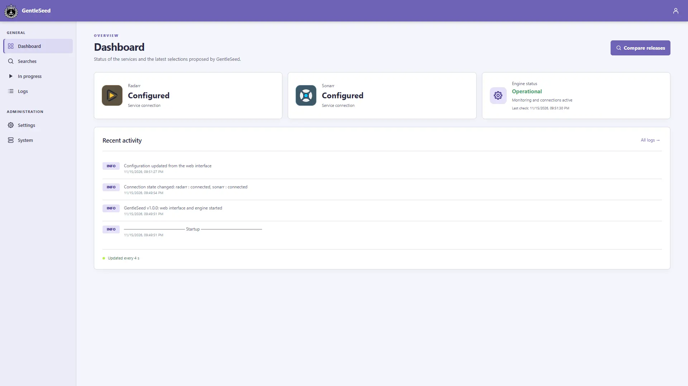 | 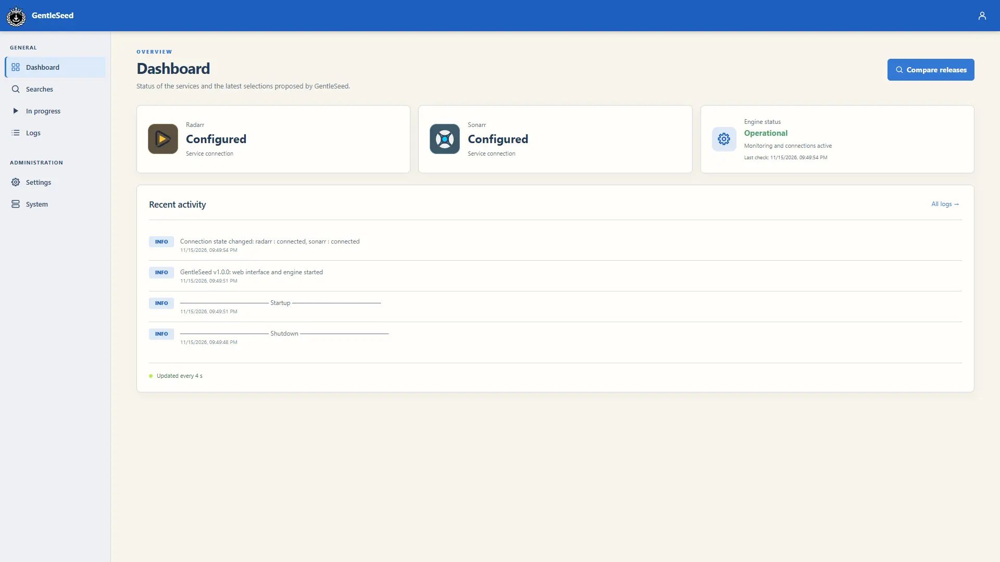 |
| Gentle Mates · Violet (Paris 2027) | |
| 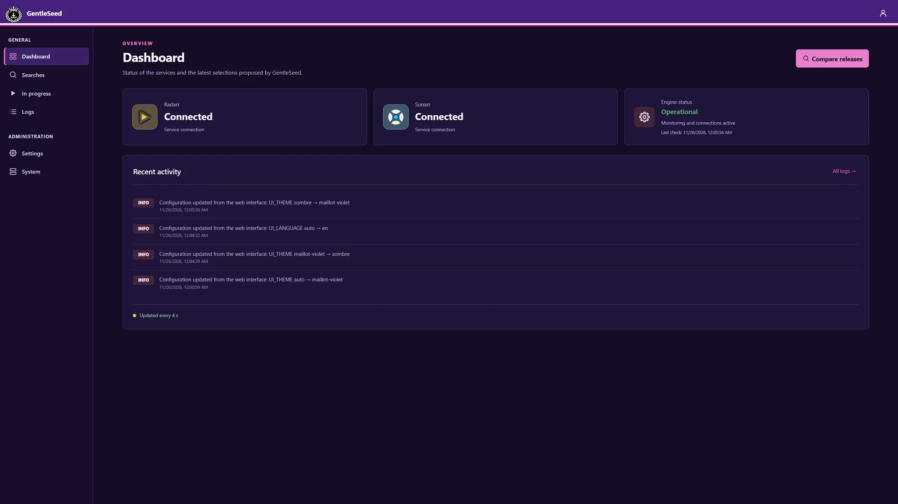 | |

</details>

## Démarrage rapide

```bash
docker run -d --name gentleseed --restart unless-stopped --stop-timeout 30 \
  -p 1853:1853 -v gentleseed_data:/data \
  starkev/gentleseed:latest
```

Ouvrez `http://IP-DU-SERVEUR:1853`, suivez la page de premier lancement (thème et connexion), puis saisissez l'adresse et la clé API de Radarr et/ou Sonarr dans **Paramètres → Connexions**.

> Avant de commencer, décochez la recherche automatique à l'ajout dans Radarr/Sonarr (et Seerr/Overseerr), sinon ils cherchent de leur côté et vous obtenez des **doubles téléchargements**. Voir le [guide d'installation](./docs/INSTALL.fr.md#éviter-un-double-téléchargement-important).

Docker Compose, TrueNAS SCALE et un lancement sans Docker (Python) sont décrits dans le [guide d'installation](./docs/INSTALL.fr.md).

## Documentation

- [Guide d'installation](./docs/INSTALL.fr.md) — Docker Compose, image Docker, Python, éviter un double téléchargement, sécurité, notes, structure du projet
- [Docker / TrueNAS SCALE](./docs/README_DOCKER.fr.md) — port, contrôle de santé, application personnalisée
- [Changelog](./CHANGELOG.md)
- [Contribuer](./CONTRIBUTING.md) · [Politique de sécurité](./.github/SECURITY.md)

## Soutenir le projet

Si vous appréciez GentleSeed, pensez à mettre une étoile au dépôt GitHub.

## Auteur

| [StarKev](https://github.com/StarKev) |
|---------------------------------------|
| [](https://github.com/StarKev) |

## Licence

Copyright (C) 2026 Kevin Lemos Graça (StarKev) — KLG Digital.

Ce projet est distribué sous la **GNU Affero General Public License v3.0** (AGPL-3.0). Consultez le fichier [LICENSE](./LICENSE) pour plus de détails.
