<div align="center">

<h1 align="center">
<br>
<a href="https://github.com/KLG-Digital"></a>
<br>
<b>GentleSeed</b>
<br>
</h1>

**English** · [Français](./README.fr.md)

[](https://github.com/KLG-Digital/GentleSeed/releases)
[](https://hub.docker.com/r/starkev/gentleseed)
[](https://github.com/KLG-Digital/GentleSeed)
[](https://github.com/KLG-Digital/GentleSeed)
[](./LICENSE)

[**Install**](#quick-start) · [**Features**](#features) · [**Documentation**](#documentation) · [**Changelog**](./CHANGELOG.md)

</div>

---

## Description

**GentleSeed** is a release selector for **Radarr** and **Sonarr**. It watches for newly added movies and series, compares the releases that Radarr/Sonarr find (eligibility, seeders, preferred codec) and hands the best one back to Radarr/Sonarr — through a clean web interface available in **14 languages**.

GentleSeed **never contacts your download client directly**: Radarr and Sonarr stay in charge of the download. GentleSeed is an independent project and is not affiliated with Radarr, Sonarr or Prowlarr.

## How it works

1. Radarr/Sonarr tell GentleSeed that a movie or series was added (webhook, with a light check every 15 s as a safety net).
2. GentleSeed asks Radarr/Sonarr for the available releases and keeps the ones they accept.
3. It ranks them by seeders and, if you wish, by preferred codec (H.264 / H.265), then sends the best one back to Radarr/Sonarr.

## Features

| # | Feature | Description |
|---|---------|-------------|
| 1 | New media only | The library present at first start is ignored; only later additions are handled |
| 2 | Instant detection | Webhook installed in Radarr/Sonarr from the interface, plus a light check every 15 s |
| 3 | Release choice | Radarr/Sonarr decide eligibility; GentleSeed ranks by seeders and preferred codec |
| 4 | Season packs | Sonarr: tries a season pack first, then episode by episode |
| 5 | Manual search | Compare the releases of any missing media and send one after a confirmation |
| 6 | Anti-duplicate | Checks the queue and history of Radarr/Sonarr before any hand-off |
| 7 | Live activity | Search in progress, requests received, queue, downloads tracking and recent results |
| 8 | Logs | Filterable events, colored log file preview, download in your language |
| 9 | Backups | Back up and restore your settings (API keys only on request) |
| 10 | Update notice | Reads the GitHub releases and informs you — it never updates itself |
| 11 | Languages & themes | 14 languages, dark / light / automatic and team-color themes |
| 12 | Indexers to ignore | Tick the indexers (read from Radarr and Sonarr) that GentleSeed must never choose from |
| 13 | No release in your language | A release refused only for its language can be sent anyway after confirmation, or automatically after N empty searches (off by default) |

## Preview

Screenshots of the interface in English (14 languages available).

<details open>
<summary><b>Pages</b></summary>
<br>

| Dashboard | Searches |
|:---:|:---:|
| 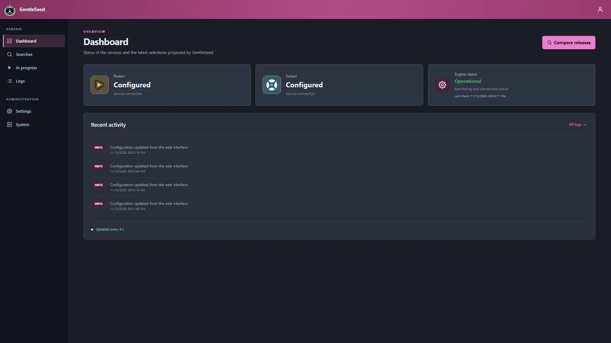 | 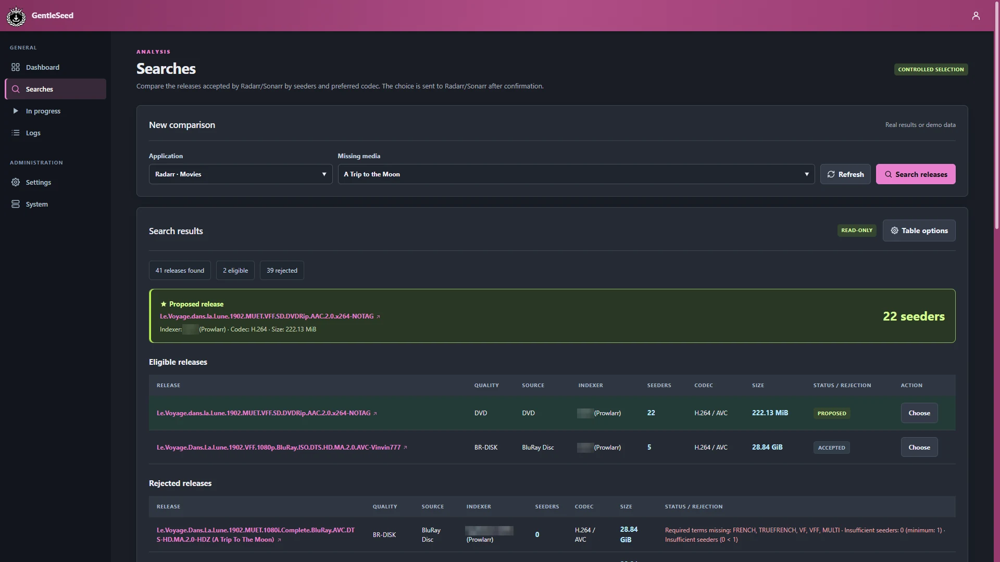 |
| In progress | Logs |
| 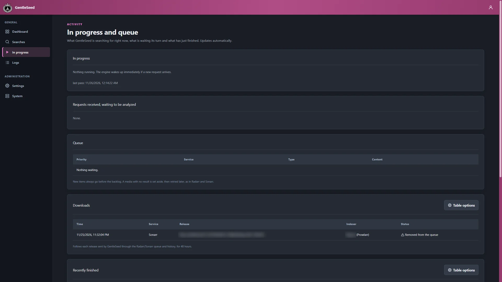 | 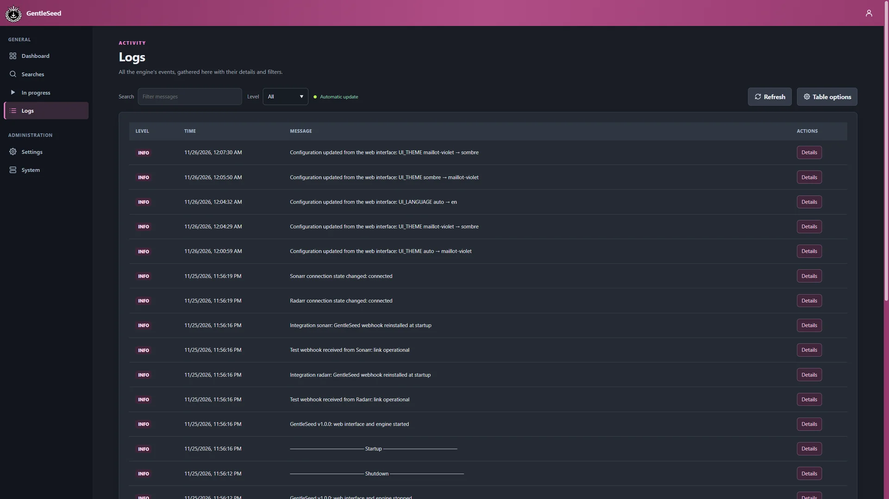 |
| Settings | System |
| 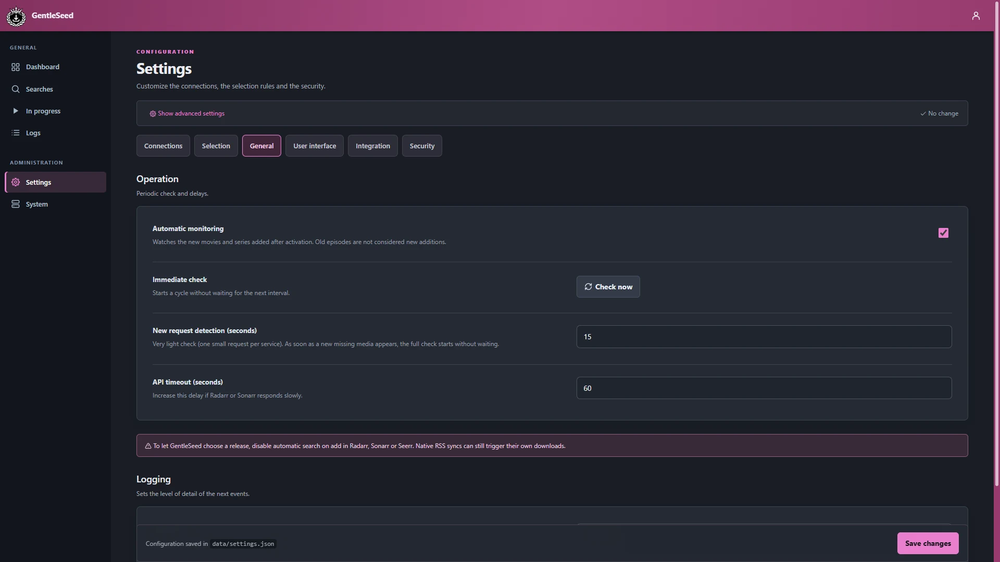 | 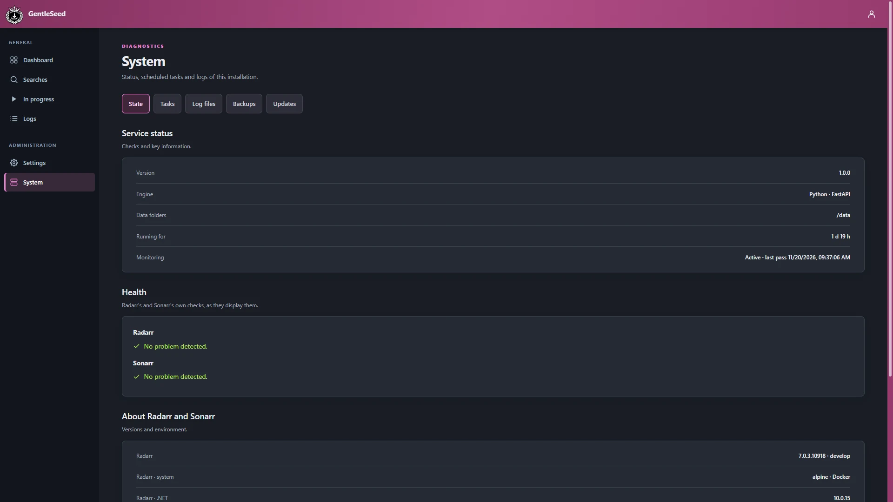 |

</details>

<details open>
<summary><b>Mobile</b></summary>
<br>

| Dashboard | Searches | In progress | Logs |
|:---:|:---:|:---:|:---:|
| 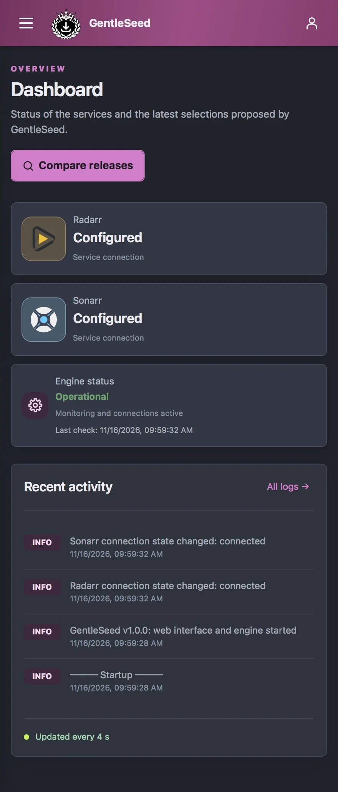 | 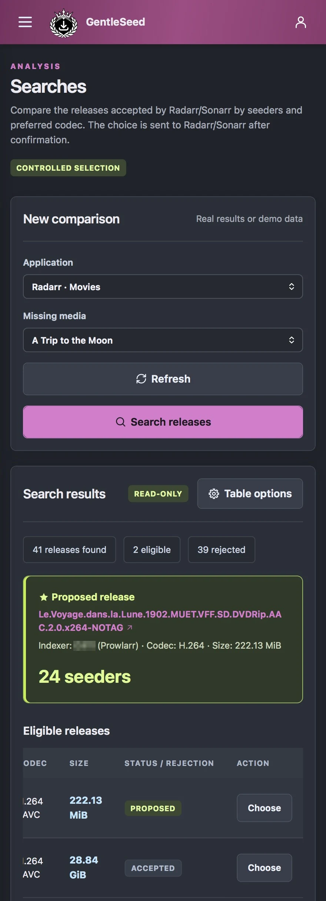 | 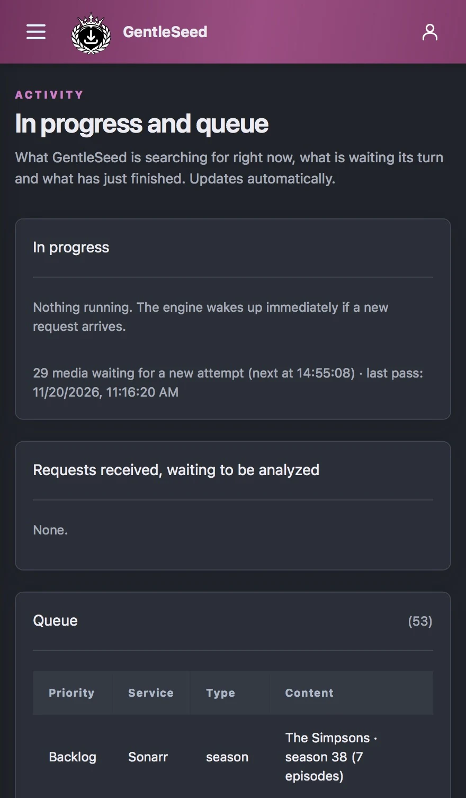 | 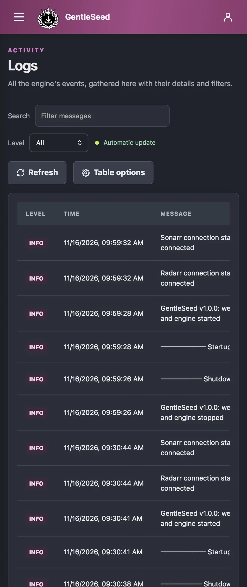 |

</details>

<details>
<summary><b>Themes</b></summary>
<br>

**Auto** follows your operating system (dark or light). The last five are the **Gentle Mates** team-color themes, including **Violet (Paris 2027)**.

| Dark | Light |
|:---:|:---:|
|  | 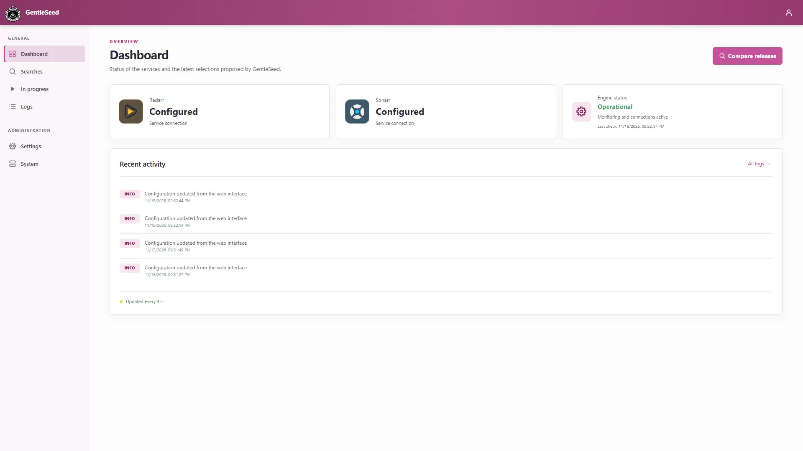 |
| Gentle Mates · Pastel pink | Gentle Mates · Dark |
| 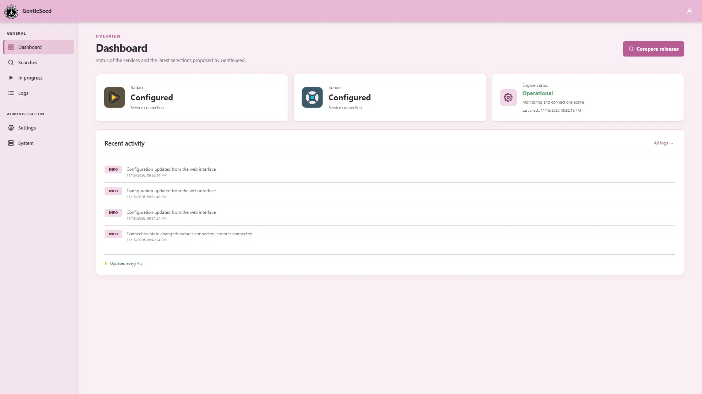 | 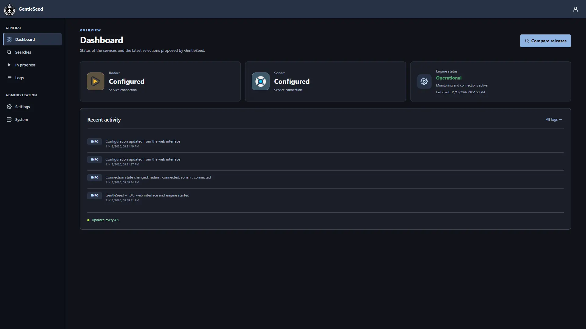 |
| Gentle Mates · Paris (lavender) | Gentle Mates · Blue |
| 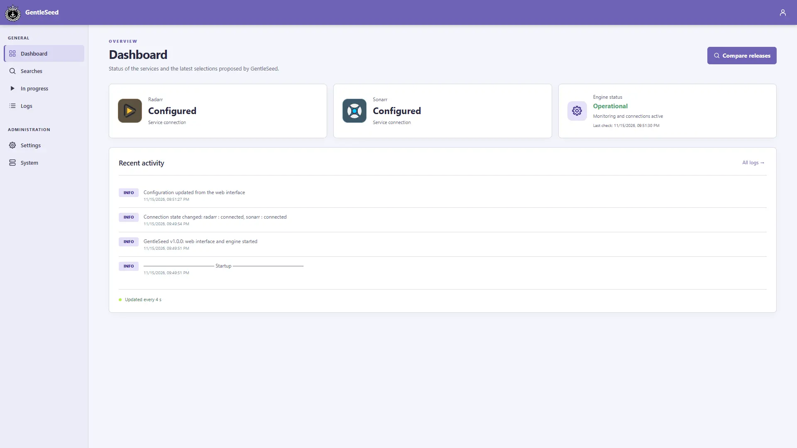 | 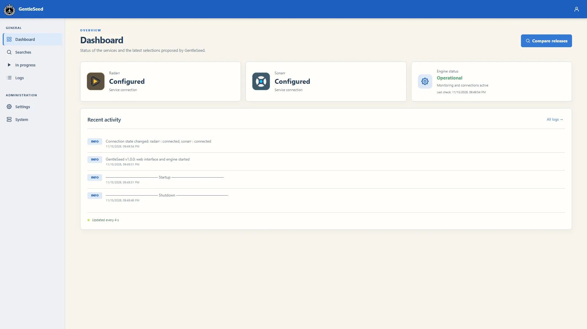 |
| Gentle Mates · Violet (Paris 2027) | |
| 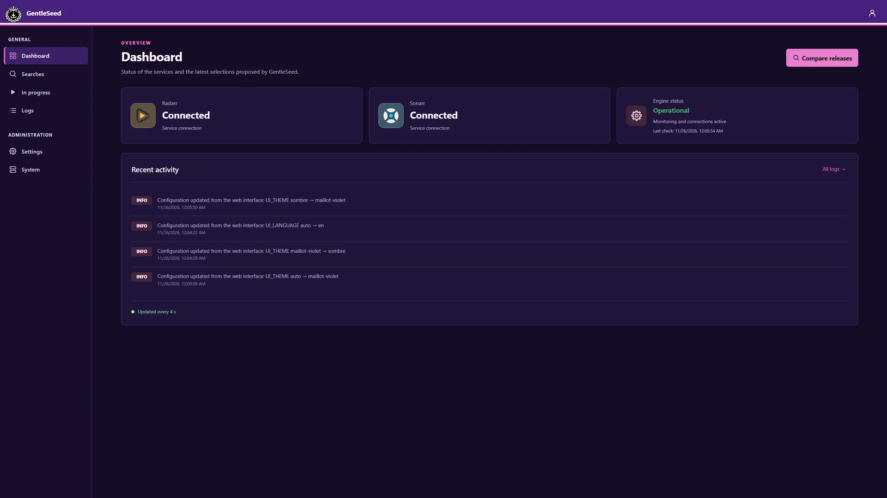 | |

</details>

## Quick start

```bash
docker run -d --name gentleseed --restart unless-stopped --stop-timeout 30 \
  -p 1853:1853 -v gentleseed_data:/data \
  starkev/gentleseed:latest
```

Open `http://SERVER-IP:1853`, follow the first-launch page (theme and sign-in), then enter the address and API key of Radarr and/or Sonarr in **Settings → Connections**.

> Before you start, untick the automatic search on add in Radarr/Sonarr (and Seerr/Overseerr), otherwise they search on their own and you get **double downloads**. See the [installation guide](./docs/INSTALL.md#avoid-double-downloads-important).

Docker Compose, TrueNAS SCALE and a run without Docker (Python) are described in the [installation guide](./docs/INSTALL.md).

## Documentation

- [Installation guide](./docs/INSTALL.md) — Docker Compose, Docker image, Python, avoiding double downloads, security, notes, project structure
- [Docker / TrueNAS SCALE](./docs/README_DOCKER.md) — port, health check, custom app
- [Changelog](./CHANGELOG.md)
- [Contributing](./CONTRIBUTING.md) · [Security policy](./.github/SECURITY.md)

## Support the Project

If you enjoy GentleSeed, consider starring the repository on GitHub.

## Author

| [StarKev](https://github.com/StarKev) |
|---------------------------------------|
| [](https://github.com/StarKev) |

## License

Copyright (C) 2026 Kevin Lemos Graça (StarKev) — KLG Digital.

This project is licensed under the **GNU Affero General Public License v3.0** (AGPL-3.0). See the [LICENSE](./LICENSE) file for details.
